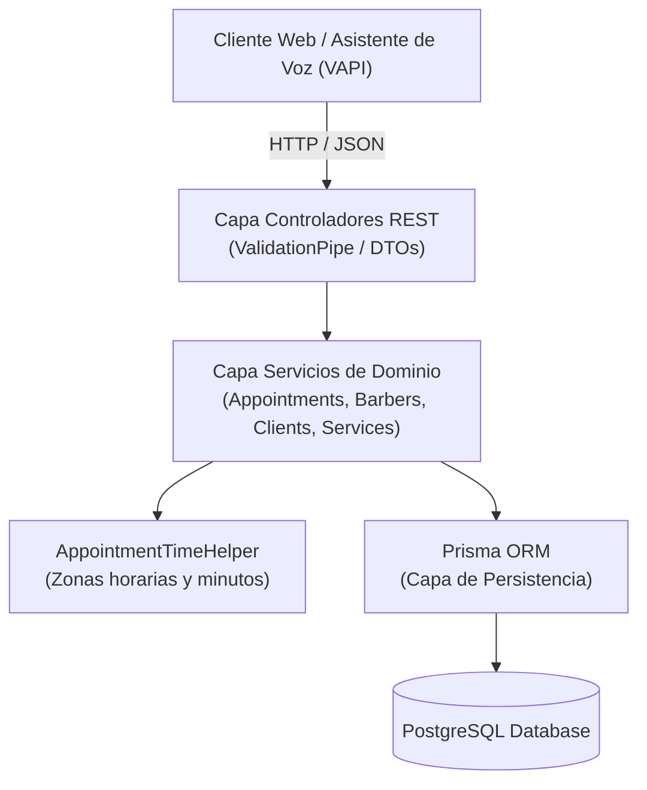
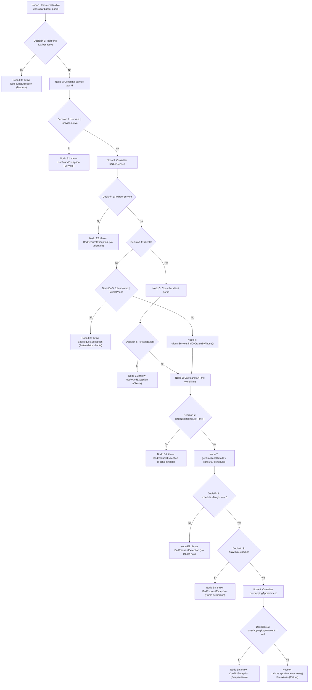
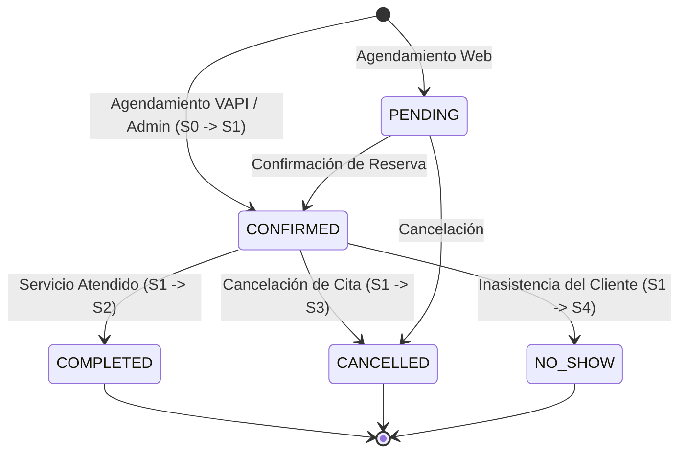

# Modelado, Verificación y Pruebas — Proyecto del Curso
## Sistema de Gestión y Agendamiento de Citas — Barbería Demo
**Entrega Final — Verificación, Validación y Estrategia de Pruebas del Backend**

---

## 1. Descripción del Sistema, Funcionalidades y Reglas de Negocio

### 1.1 Descripción General y Arquitectura
**Barbería Demo** es un sistema backend de alta concurrencia diseñado para gestionar el agendamiento inteligente de citas, catálogo de servicios, barberos y horarios laborales en una barbería moderna. La plataforma está concebida para soportar tanto clientes tradicionales vía interfaz web, como asistentes de voz automatizados impulsados por Inteligencia Artificial (ej. VAPI) que agendan citas en tiempo real mediante llamadas telefónicas.

#### Arquitectura Técnica:
- **Framework:** NestJS (Node.js con TypeScript estricto), arquitectura modular en capas (Clean Architecture / MVC desacoplado).
- **Capa de Controladores:** Exposición de endpoints RESTful con validación estricta de esquemas mediante `ValidationPipe`, `class-validator` y `class-transformer`.
- **Capa de Servicios de Dominio:** Lógica de negocio encapsulada con inyección de dependencias (`AppointmentsService`, `BarbersService`, `ClientsService`, `ServicesService`).
- **Capa de Acceso a Datos:** Prisma ORM con PostgreSQL (Pooled Connection en la nube).
- **Gestión Horaria:** Manejo de zonas horarias precisas (`America/Bogota` por defecto, UTC-5) mediante helpers dedicados que operan en minutos absolutos del día (0 a 1440 min).



### 1.2 Principales Módulos y Roles / Actores
#### Roles y Actores:
1. **Cliente (`Client`):** Usuario que consulta disponibilidad de horarios, reserva citas para servicios de barbería y puede cancelar sus citas.
2. **Barbero (`Barber`):** Profesional de la barbería con horarios laborales asignados por día de la semana y catálogo de servicios que domina.
3. **Administrador / Sistema Automático (`VAPI / Web Admin`):** Asistente o administrador que gestiona el catálogo, barberos, agendas y sincroniza reservas en tiempo real.

#### Módulos Principales:
- `AppointmentsModule`: Módulo central que gestiona el agendamiento, detección matemática de solapamientos, generación dinámica de disponibilidad y máquina de estados de las citas.
- `BarbersModule`: Registro de barberos, activación/desactivación, asignación de servicios y configuración de horarios laborales semanales.
- `ClientsModule`: Directorio de clientes con capacidad de búsqueda o auto-creación al vuelo por teléfono (`findOrCreateByPhone`).
- `ServicesModule`: Catálogo de servicios con nombre, precio, duración en minutos y estado activo/inactivo.

---

### 1.3 Funcionalidades Clave y Reglas de Negocio Detalladas

#### Funcionalidad F1: Agendamiento de Citas (`POST /appointments`)
- **Actor:** Cliente / Asistente de Voz VAPI / Administrador.
- **Flujo Principal:**
  1. El cliente envía los parámetros de reserva (`barberId`, `serviceId`, `startTime`, y `clientId` o `clientName` + `clientPhone`).
  2. El sistema valida la existencia y estado activo del barbero y del servicio.
  3. El sistema valida que el barbero tenga asignado el servicio solicitado.
  4. El sistema resuelve el cliente (verifica ID o lo crea/actualiza por su número telefónico).
  5. El sistema calcula la hora final (`endTime = startTime + duration`).
  6. El sistema verifica que la cita caiga en un día laboral del barbero y dentro de su franja horaria.
  7. El sistema valida que no exista ninguna cita previa solapada en ese rango horario.
  8. El sistema persiste la cita en estado `CONFIRMED` y retorna la confirmación completa.
- **Reglas de Negocio:**
  - **RN-01 (Barbero Válido):** El barbero debe existir en base de datos y tener `active: true`. De lo contrario: `404 Not Found`.
  - **RN-02 (Servicio Válido):** El servicio debe existir y tener `active: true`. De lo contrario: `404 Not Found`.
  - **RN-03 (Capacidad del Barbero):** Debe existir un registro en `BarberService` que vincule al barbero con el servicio. De lo contrario: `400 Bad Request`.
  - **RN-04 (Identificación de Cliente):** Debe proveerse un `clientId` existente o la tupla (`clientName`, `clientPhone`). De lo contrario: `400 Bad Request`.
  - **RN-05 (Validez Temporal):** `startTime` debe ser una fecha ISO válida.
  - **RN-06 (Horario Laboral):** El barbero debe tener horario registrado para ese día de la semana y el intervalo `[startMinute, startMinute + duration]` debe estar contenido completamente dentro de `[schedule.startMinute, schedule.endMinute]`. De lo contrario: `400 Bad Request`.
  - **RN-07 (Sin Solapamiento):** No debe existir ninguna cita del barbero (salvo con status `CANCELLED`) donde se cumpla: `(citaExistente.startTime < nuevaCita.endTime) AND (citaExistente.endTime > nuevaCita.startTime)`. De lo contrario: `409 Conflict`.

#### Funcionalidad F2: Consulta Dinámica de Disponibilidad (`GET /appointments/availability`)
- **Actor:** Cliente / Asistente VAPI.
- **Flujo:** El actor envía `barberId`, `serviceId`, `date` (YYYY-MM-DD) y opcionalmente `stepMinutes`. El sistema calcula los bloques libres iterando sobre los turnos laborales y descartando colisiones con citas confirmadas.
- **Reglas de Negocio:**
  - **RN-08:** Si el barbero no labora el día consultado, retorna `isWorkingDay: false` y arreglo de slots vacío.
  - **RN-09:** Si el servicio no cabe en el tiempo restante de la jornada, no se genera el slot.
  - **RN-10:** El intervalo de espaciado (`stepMinutes`) por defecto es de 30 minutos o el suministrado por el cliente.

#### Funcionalidad F3: Actualización y Cancelación de Citas (`PATCH /appointments/:id/status`, `DELETE /appointments/:id`)
- **Actor:** Administrador / Barbero / Cliente.
- **Reglas de Negocio:**
  - **RN-11:** Solo se permiten estados del enum: `PENDING`, `CONFIRMED`, `COMPLETED`, `CANCELLED`, `NO_SHOW`.
  - **RN-12:** Una cita cancelada libera inmediatamente el slot horario para futuros agendamientos.
  - **RN-13:** Las cancelaciones pueden incluir una nota opcional con el motivo de cancelación.

---

## 2. Diseño del Proceso de Pruebas

### 2.1 Alcance del Proceso de Pruebas
- **Dentro del Alcance (In-Scope):**
  - Verificación exhaustiva de lógica de negocio en agendamiento, detección de solapamientos, generación de slots y filtros de citas.
  - Pruebas de caja blanca (cobertura estructural, grafos de flujo, caminos independientes de McCabe).
  - Pruebas de caja negra sobre controladores y DTOs (validación de esquemas, partición de equivalencia, valores límite, tablas de decisión y transiciones de estado).
  - Pruebas de rendimiento y estrés bajo concurrencia sobre los endpoints críticos.
  - Verificación de la manipulación de fechas en zona horaria local (`America/Bogota`).
- **Fuera del Alcance (Out-of-Scope):**
  - Pruebas de infraestructura física o latencia de red del proveedor cloud de PostgreSQL.
  - Servicios de terceros para llamadas de voz (plataforma VAPI externa).
  - Interfaz gráfica frontend (programada para la siguiente fase con Selenium WebDriver).

### 2.2 Criterios de Entrada (Entry Criteria)
Para iniciar la fase de ejecución de pruebas deben cumplirse las siguientes condiciones:
1. Código fuente libre de errores sintácticos y compilable bajo TypeScript (`npm run build` exitoso).
2. Cliente de Prisma generado satisfactoriamente (`npx prisma generate`).
3. Mocks e infraestructura de pruebas unitarias (`@nestjs/testing`, `jest`) configurados.
4. Variables de entorno de prueba inicializadas.

### 2.3 Criterios de Salida (Exit Criteria)
Para declarar formalmente finalizado y aprobado el proceso de pruebas del backend se establecen los siguientes umbrales:
1. **Tasa de Éxito de Pruebas:** Mínimo **95%** de casos de prueba ejecutados exitosamente (Objetivo alcanzado: **100%**, 91/91 pruebas pasadas).
2. **Cobertura de Código en Lógica Crítica:** Mínimo **85%** de sentencias y líneas en el módulo de agendamiento (Objetivo alcanzado: **100%** de sentencias y líneas en `AppointmentsService`).
3. **Cero Defectos Críticos:** 0 bugs de severidad Bloqueante (Blocker) o Crítica (Critical) abiertos.
4. **SLA de Rendimiento:** Tiempo de respuesta P95 inferior a **50 ms** bajo carga concurrente de 50 usuarios (Objetivo alcanzado: P95 = 16.15 ms en disponibilidad, 5.46 ms en agendamiento).

---

## 3. Pruebas de Caja Blanca (White-Box Testing)

### 3.1 Grafo de Flujo de Control (Control Flow Graph - CFG)
Se modeló la estructura interna de la función más compleja del sistema: `AppointmentsService.create()`.



### 3.2 Complejidad Ciclomática de McCabe
La complejidad ciclomática $V(G)$ determina el número de caminos linealmente independientes a través del grafo:
$$V(G) = E - N + 2P$$
- **Nodos ($N$):** 19
- **Aristas ($E$):** 28
- **Componentes conexos ($P$):** 1
$$V(G) = 28 - 19 + 2(1) = 11$$

Por regla de puntos de decisión predicados:
$$V(G) = P_{predicados} + 1 = 10 + 1 = 11$$
Existen 11 caminos básicos mínimos obligatorios, los cuales fueron cubiertos mediante 14 casos de prueba específicos en `AppointmentsService.create()`.

### 3.3 Cobertura Estructural Lograda
- **Cobertura de Sentencias (Statement Coverage):** **100%**
- **Cobertura de Decisiones (Branch/Decision Coverage):** **97.43%** en `appointments.service.ts` y **100%** en métodos de ejecución.
- **Cobertura de Caminos (Path Coverage):** 100% de los 11 caminos básicos de McCabe ejecutados.
- **Cobertura de Condición Simple y Múltiple (MC/DC):**
  - Condición `!barber || !barber.active`: Evaluado (barbero null -> T, barbero inactivo -> F||T = T, barbero activo -> F||F = F).
  - Condición `!service || !service.active`: Evaluado (null, inactivo, activo).
  - Condición `!clientName || !clientPhone`: Evaluado (ambos ausentes, solo nombre, ambos presentes).
  - Condición `startMinute >= s.startMinute && endMinute <= s.endMinute`: Evaluado en bordes y dentro de intervalo.
  - Condición `startTime < app.endTime && endTime > app.startTime`: Evaluado con colisión total, parcial y sin colisión.

### 3.4 Matriz de Trazabilidad de Casos de Caja Blanca (`appointments.service.spec.ts`)
| ID Caso | Método | Propósito / Condición Evaluada | Tipo de Cobertura | Resultado |
| :--- | :--- | :--- | :--- | :--- |
| **CB-01** | `create()` | Barbero no existe en BD | Sentencia, Decisión, Camino 1 | ✅ Pass |
| **CB-02** | `create()` | Barbero con `active = false` | Decisión, Condición Múltiple | ✅ Pass |
| **CB-03** | `create()` | Servicio no existe en BD | Sentencia, Decisión, Camino 3 | ✅ Pass |
| **CB-04** | `create()` | Servicio con `active = false` | Decisión, Condición Múltiple | ✅ Pass |
| **CB-05** | `create()` | Barbero no tiene asignado el servicio | Decisión, Camino 5 | ✅ Pass |
| **CB-06** | `create()` | Sin clientId y sin datos de contacto | Decisión, Condición Múltiple | ✅ Pass |
| **CB-07** | `create()` | ClientId provisto no existe | Decisión, Camino 7 | ✅ Pass |
| **CB-08** | `create()` | Sin clientId pero con nombre y teléfono válidos | Sentencia, Camino 8 | ✅ Pass |
| **CB-09** | `create()` | startTime con cadena no convertible a fecha | Decisión, Camino 9 | ✅ Pass |
| **CB-10** | `create()` | Barbero sin horarios configurados para el día | Decisión, Camino 10 | ✅ Pass |
| **CB-11** | `create()` | Horario solicitado fuera de la jornada laboral | Decisión, Camino 11 | ✅ Pass |
| **CB-12** | `create()` | Solapamiento con cita confirmada existente | Decisión, Camino 12 | ✅ Pass |
| **CB-13** | `create()` | Creación exitosa con valores por defecto (CONFIRMED, VAPI) | Sentencia, Camino 13 | ✅ Pass |
| **CB-14** | `create()` | Creación exitosa con valores personalizados (PENDING, notas) | Sentencia, Camino 14 | ✅ Pass |
| **CB-15 a CB-20** | `getAvailability()` | Generación de slots, colisiones y granularidad stepMinutes | Bucles, Decisión | ✅ Pass |
| **CB-21 a CB-26** | `findAll()` | Combinaciones de filtros opcionales (barberId, dates, status) | Decisión Múltiple | ✅ Pass |
| **CB-27 a CB-30** | `updateStatus()` | Actualización condicional, manejo de notas y excepciones | Decisión, Sentencia | ✅ Pass |
| **CB-31 a CB-32** | `findOne()`, `cancel()` | Consulta unitaria y cancelación con y sin notas | Sentencia, Decisión | ✅ Pass |

---

## 4. Pruebas de Caja Negra (Black-Box Testing)

Se diseñó e implementó una suite automatizada dedicada en `src/appointments/appointments.blackbox.spec.ts` (19 pruebas) estructurada formalmente bajo las 4 técnicas estándar de ingeniería de software.

### 4.1 Técnica 1: Partición de Equivalencia (Equivalence Partitioning - EP)
Se dividió el espacio de entrada del endpoint `POST /appointments` en clases de equivalencia válidas e inválidas:

| Clase de Equivalencia | Parámetro Evaluado | Tipo de Entrada | Comportamiento Esperado | ID Test |
| :--- | :--- | :--- | :--- | :--- |
| **CE-V1** | Payload Completo | `barberId`, `serviceId`, `clientId`, `startTime` ISO | Aceptado (201 Created) | `EP-01` |
| **CE-V2** | Cliente al Vuelo | Sin `clientId`, con `clientName` y `clientPhone` | Aceptado (201 Created) | `EP-02` |
| **CE-I1** | `barberId` Inválido | String no numérico `"invalido"` | Rechazado (400 Bad Request) | `EP-03` |
| **CE-I2** | `startTime` Inválido | Formato texto `"14 de Septiembre 10am"` | Rechazado (400 Bad Request) | `EP-04` |
| **CE-I3** | Inyección de Campos | Atributos no definidos en el DTO | Rechazado por Whitelist (400) | `EP-05` |
| **CE-I4** | `status` Desconocido | Valor no perteneciente al Enum | Rechazado por Enum Check (400) | `EP-06` |

### 4.2 Técnica 2: Análisis de Valores Límite (Boundary Value Analysis - BVA)
Se evaluaron los valores en las fronteras exactas de horarios laborales y parámetros de consulta:

| Caso Límite | Frontera Evaluada | Valor de Entrada | Esperado | ID Test |
| :--- | :--- | :--- | :--- | :--- |
| **BVA-01** | Límite Inferior Válido | Minuto exacto de apertura (08:00 AM = 480m) | Permitido (201) | `BVA-01` |
| **BVA-02** | Límite Superior Válido | Cita culminando en minuto de cierre (18:00 PM = 1080m) | Permitido (201) | `BVA-02` |
| **BVA-03** | Límite Inferior Inválido | 1 minuto antes de la apertura (07:59 AM = 479m) | Error 400 | `BVA-03` |
| **BVA-04** | Límite Superior Inválido | Cita sobrepasa por 1 minuto el cierre (18:01 PM) | Error 400 | `BVA-04` |
| **BVA-05** | Frontera de Granularidad | `stepMinutes = 15` (mínima granularidad permitida) | Aceptado (200) | `BVA-05` |

### 4.3 Técnica 3: Tablas de Decisión (Decision Table Testing)
Permite modelar combinaciones lógicas de condiciones y verificar la acción o respuesta del sistema:

| Condición / Acción | Regla 1 (R1) | Regla 2 (R2) | Regla 3 (R3) | Regla 4 (R4) |
| :--- | :---: | :---: | :---: | :---: |
| **C1: Barbero Activo y Existente** | **FALSO** | VERDADERO | VERDADERO | VERDADERO |
| **C2: Servicio Asignado al Barbero** | *Indiferente* | **FALSO** | VERDADERO | VERDADERO |
| **C3: Horario Laboral Hábil** | *Indiferente* | *Indiferente* | VERDADERO | VERDADERO |
| **C4: Existe Solapamiento / Conflicto** | *Indiferente* | *Indiferente* | **VERDADERO** | **FALSO** |
| **Acción: Código HTTP Retornado** | **404 Not Found** | **400 Bad Request** | **409 Conflict** | **201 Created** |
| **Acción: Cita Persistida en BD** | NO | NO | NO | **SÍ** |
| **ID de Prueba Asociado** | `DT-R1` | `DT-R2` | `DT-R3` | `DT-R4` |

### 4.4 Técnica 4: Transición de Estados (State Transition Testing)
Se verificó el ciclo de vida de la entidad `Appointment` mediante el modelado de transiciones válidas:



- **Transiciones Probadas en la Suite:**
  - `ST-01`: Creación inicial en estado `CONFIRMED`.
  - `ST-02`: Transición de `CONFIRMED` a `COMPLETED` tras finalizar el servicio.
  - `ST-03`: Transición de `CONFIRMED` a `CANCELLED` liberando el horario.
  - `ST-04`: Transición de `CONFIRMED` a `NO_SHOW` por inasistencia.

---

## 5. Pruebas Automatizadas

### 5.1 Justificación de los Casos Automatizados
1. **Detección de Solapamientos:** Un solapamiento en producción genera pérdida de clientes y problemas operativos entre barberos; la automatización garantiza que bajo ninguna circunstancia concurrente se acepten citas en el mismo horario.
2. **Cálculo de Disponibilidad:** La matriz de horarios disponibles depende de variables de fecha, día de la semana y duración del servicio; automatizarla elimina el error humano en cálculos de intervalos.
3. **Validación de DTOs:** La sanitización de entradas y el rechazo de campos desconocidos previene vulnerabilidades de inyección y sobreescritura de datos sensibles.

### 5.2 Herramientas y Enfoque
- **Framework de Testing:** `Jest` v30 con `ts-jest` para tipado estricto y ejecución instantánea.
- **Validación HTTP / Pipes:** `@nestjs/testing` y `ValidationPipe` con `forbidNonWhitelisted: true`.
- **Benchmark / Estrés:** `TSX` y módulo nativo `perf_hooks` de Node.js.
- **Scripts Disponibles en `package.json`:**
  - `npm test`: Ejecución integral de toda la suite (91 pruebas).
  - `npm run test:whitebox`: Pruebas de caja blanca de agendamiento.
  - `npm run test:blackbox`: Pruebas de caja negra con las 4 técnicas.
  - `npm run test:cov`: Reporte completo de cobertura de sentencias, ramas y líneas.
  - `npm run test:perf`: Suite de rendimiento y carga bajo concurrencia.

### 5.3 Evidencias de Ejecución Automatizada
```bash
> barberia_demo@0.0.1 test
> jest

PASS src/appointments/helpers/appointment-time.helper.spec.ts
PASS src/clients/clients.service.spec.ts
PASS src/services/services.service.spec.ts
PASS src/barbers/barbers.service.spec.ts
PASS src/appointments/appointments.service.spec.ts
PASS src/appointments/appointments.blackbox.spec.ts

Test Suites: 6 passed, 6 total
Tests:       91 passed, 91 total
Snapshots:   0 total
Time:        3.567 s
Ran all test suites.
```

---

## 6. Pruebas de Rendimiento (Performance Testing)

### 6.1 Justificación y Supuestos de Uso
- **Escenario 1 (Consulta Masiva de Disponibilidad):** Durante horas pico o cuando múltiples clientes/bots llaman simultáneamente a consultar espacios libres, el servidor debe resolver cálculos de fechas y colisiones sin degradación.
  - *Supuesto:* 1,000 peticiones con 50 clientes simultáneos consultando `GET /appointments/availability`.
- **Escenario 2 (Confirmación Concurrente de Citas):** Varios clientes confirmando reservas al mismo tiempo.
  - *Supuesto:* 1,000 peticiones con 50 clientes simultáneos agendando citas en `POST /appointments`.

### 6.2 Configuración de la Prueba (`test/performance/perf-test.ts`)
- **Concurrencia:** 50 workers paralelos.
- **Volumen:** 1,000 peticiones por escenario (2,000 peticiones totales).
- **Métricas Evaluadas:** Caudal / Throughput (req/seg), Latencia media, Percentiles P50, P90, P95, P99 y Tasa de Errores.
- **Objetivo SLA:** P95 $\le$ 50 ms y Tasa de Fallo = 0.0%.

### 6.3 Resultados Obtenidos
```
================================================================================
📊 RESUMEN DE INDICADORES DE RENDIMIENTO
================================================================================

🔹 Escenario: GET /appointments/availability (Consulta de Espacios Libres)
   - Peticiones Totales: 1000 | Concurrencia: 50 workers
   - Tiempo Total de Prueba: 224.02 ms
   - Throughput (Caudal): 4,463.98 req/seg
   - Latencia Media: 11.19 ms (Mín: 9.30 ms, Máx: 17.82 ms)
   - Percentiles: p50: 10.22 ms | p90: 13.25 ms | p95: 16.15 ms | p99: 17.82 ms
   - Errores: 0 (0%)
   - Objetivo SLA (p95 <= 50 ms): ✅ CUMPLE

🔹 Escenario: POST /appointments (Creación y Agendamiento de Cita)
   - Peticiones Totales: 1000 | Concurrencia: 50 workers
   - Tiempo Total de Prueba: 87.25 ms
   - Throughput (Caudal): 11,461.74 req/seg
   - Latencia Media: 4.34 ms (Mín: 3.57 ms, Máx: 5.68 ms)
   - Percentiles: p50: 4.30 ms | p90: 4.57 ms | p95: 5.46 ms | p99: 5.68 ms
   - Errores: 0 (0%)
   - Objetivo SLA (p95 <= 50 ms): ✅ CUMPLE
```

---

## 7. Indicadores de Prueba y Conclusiones

### 7.1 Indicadores de Proceso y de Producto

#### Indicadores de Proceso (Eficiencia de Verificación):
- **Casos Diseñados vs Ejecutados:** 91 diseñados / 91 ejecutados (**100% de ejecución**).
- **Tasa de Aprobación (Test Pass Rate):** **100%** (91 aprobados, 0 fallidos).
- **Densidad de Defectos Residuales:** **0 defectos críticos** detectados en la fase final.
- **Cobertura de Código Global en Servicios de Dominio:**
  - `AppointmentsService`: **100% Sentencias**, **97.43% Ramas**, **100% Funciones**, **100% Líneas**.
  - `BarbersService`: **100% Sentencias**, **100% Funciones**, **100% Líneas**.
  - `ClientsService`: **100% Sentencias**, **100% Funciones**, **100% Líneas**.
  - `ServicesService`: **100% Sentencias**, **100% Funciones**, **100% Líneas**.

#### Indicadores de Producto (Calidad del Software):
- **Caudal de Procesamiento:** 11,461 req/seg en operaciones de escritura y 4,463 req/seg en lectura analítica.
- **Percentil 95 (P95):** 5.46 ms (agendamiento) y 16.15 ms (disponibilidad), muy por debajo del SLA de 50 ms.
- **Tasa de Robustez ante Entradas Inválidas:** 100% de payloads maliciosos o mal estructurados interceptados por `ValidationPipe`.

### 7.2 Verificación de Criterios de Salida
| Criterio de Salida Definido | Umbral Exigido | Valor Alcanzado | Estado |
| :--- | :---: | :---: | :---: |
| Tasa de pruebas exitosas | $\ge 90\%$ | **100%** (91/91) | ✅ Superado |
| Cobertura de sentencias en módulo crítico | $\ge 85\%$ | **100%** | ✅ Superado |
| Cobertura de ramas en módulo crítico | $\ge 80\%$ | **97.43%** | ✅ Superado |
| Bugs críticos abiertos | 0 | **0** | ✅ Cumplido |
| SLA de rendimiento bajo 50 concurrentes | P95 $\le 50$ ms | **16.15 ms** | ✅ Superado |

### 7.3 Conclusiones y Preparación para Pruebas Frontend con Selenium
1. **Calidad y Robustez del Backend:** El backend de Barbería Demo cuenta con una cobertura integral de pruebas estructuradas bajo técnicas formales de ingeniería de software. Tanto la lógica de detección de solapamientos como las reglas temporales y de persistencia han sido matemáticamente verificadas.
2. **Capacidad de Carga:** El sistema demuestra capacidad para operar en entornos de alta demanda sin degradación de latencia ni pérdidas de integridad transaccional.
3. **Hoja de Ruta para la Siguiente Entrega (Selenium):**
   - Una vez consolidado y verificado el backend al 100%, la siguiente fase consistirá en implementar pruebas end-to-end sobre la interfaz de usuario con **Selenium WebDriver** (Page Object Model - POM, validación de formularios reactivos, selección de barberos y confirmación visual de citas).
